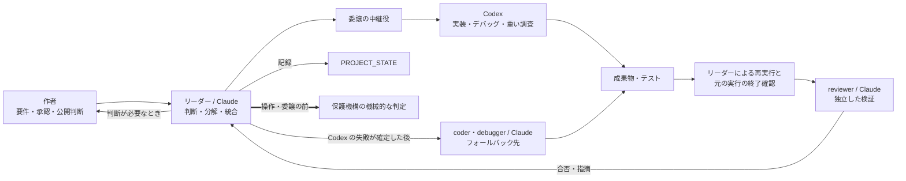

# dev-factory showcase

Claude Code と OpenAI Codex で企画から納品・検証までをつなぐ個人開発基盤 dev-factory を、文書と小さな CLI で紹介するポートフォリオです。役割分担、失敗時の引き継ぎ、品質を判断する基準を、検証の根拠と限界までたどれます。

> 記述時点: 2026-11。基盤の現在のファイルと非公開の作業記録を確認し、公開向けに概念レベルで書き下ろしたものです。内部仕様は今後変わる可能性があります。

## 1. 解決したい問題

AI に開発を任せる際、実装担当の完了報告だけでは、要件を満たしたか、テストが通ったか、途中の処理がまだ動いていないかを判断できません。担当の切り替えで編集が重なったり、実行基盤の障害と成果物の不具合を混同したりする問題もあります。

dev-factory は、企画・設計・実装・統合とデバッグ・検証・納品の受け渡しと、判断に必要な証拠をそろえるための個人用の基盤です。Web アプリや CLI など対象に応じて構成を選び、成果物を案件ごとの領域にまとめる方針で、2026-10-21 のこのリポジトリの初回作成版では納品後の学習記録まで確認しています。大規模案件の完走率や工数削減の効果は未測定です。(検証ステータス: 実機検証済み / V01)

## 2. Agent Harness として設計・制御していること

ここでいう Agent Harness は、AI に渡す役割・作業範囲・受け渡し・品質判断・中断後の扱いを組み合わせた開発の仕組みです。宣言やリーダーの手順に依存する制御と、ツールによる機械的な判定・制限を区別しています。

| 課題 | 設計判断 | 仕組み | 確認状態 | 限界 |
|---|---|---|---|---|
| 実装担当の完了報告をそのまま信用できない | 判断・実装・検証を分離する | リーダーが再検査し、独立した reviewer が要件と成果物を照合する | 2026-10-21 の初回作成版の工程と独立レビュー。(検証ステータス: 実機検証済み / V06)(検証ステータス: 実機検証済み / V01) | 採点はモデルの判断を含み、同じ点数を保証しない |
| 完了報告が欠けても実行は続いていることがある | 結果未確定として保留する | 元の実行と成果物・テストを調べ、終了確認後に1回だけ計上する | 2026-10-29 改訂版の記録再生と単体テスト。(検証ステータス: 一部検証 / V25) | 改訂後に外側の待機時間を超える新規の長時間処理を実機確認した記録はない。確定と記録はリーダーの手順 |
| 引き継ぎ時の二重編集 | 元の実行の終了を確かめてから別担当へ渡す | 判定ツールで実行状態を確認し、失敗が確定したタスクだけを引き継ぐ | 2026-10-26〜27 の隔離試験と10-31の当時版の終了確認。(検証ステータス: 一部検証 / V26) 当時の失敗後の引き継ぎ。(検証ステータス: 実機検証済み / V03) | 判定ツールは別担当の開始を機械的に止めず、背景処理が観測の外に残る場合がある |
| 実行基盤の障害と成果物の不具合の混同 | 通常の失敗とインフラ系の失敗を分ける | 通常の失敗はタスク単位で引き継ぎ、同一フェーズでインフラ系の失敗が2回続けば circuit breaker で残作業を切り替える | 旧方式の発動記録と2026-10-29改訂版の計数試験。(検証ステータス: 一部検証 / V04) | 旧方式には誤分類の事例もある。改訂後の実運用での発動は未確認 |
| AI の作業範囲と権限 | 通常経路の範囲指定と、事前承認した範囲の隔離を分ける | 範囲宣言の事前検査と変更前後の比較による事後検出は宣言・手順に依存。承認・隔離経路は承認した範囲を固定して機械的に制限する | 2026-10-26 の宣言拒否試験。(検証ステータス: 一部検証 / V17) 2026-10-16〜24 の当時版の承認・隔離・反映。(検証ステータス: 一部検証 / V18)(検証ステータス: 一部検証 / V28) | 通常経路は全書き込みを隔離しない。承認の妥当性は人の判断を含み、更新後の全経路は未確認 |
| 保護機構そのものの更新 | 評価を通った対象版だけを反映する | 隔離テストと、対象版に結び付いた独立レビューの合格を反映の条件にする | 2026-10-28 保守版の正常な評価・検証・反映経路。(検証ステータス: 実機検証済み / V30) | 中断・時間超過の全分岐は未確認。依頼文による判断の誘導は機械的に排除できない |
| 中断と再開 | 進捗を残し、再開の条件を確認する | PROJECT_STATE と作業区切りの保存を使い、明示して開始した無人実行では監督付き自動再開を使う | 2026-10-26〜27 の隔離試験と11-08の保存記録。(検証ステータス: 一部検証 / V10) 2026-09-06 当時版の再起動せず停止する経路。(検証ステータス: 一部検証 / V12) | 現在版の全条件を満たす再開は未確認。会話整理の検知記録に失敗すると停止を保証できない |
| 完了の判定 | 完了条件と検証の証拠を対応付ける | GOAL_CONTRACT で条件を固定し、completion gate と独立レビューで照合する | 2026-10-21 作成版の条件・証拠の保存と完了判断。(検証ステータス: 一部検証 / V11) | 通常開発の完了書き込みを内容で拒否する汎用コードではなく手順による判定。条件未達で blocked とした実例は未確認 |
| 作業ごとの実装担当の選択 | 委譲前に作業を分類する | リーダーが3つの実装レーン(標準・効率重視・難所向け)を選ぶ。迷う場合は標準 | 指定を渡す実装と2026-10-10当時版の指定・受領記録。(検証ステータス: 一部検証 / V22) | 分類の妥当性、速度向上、費用削減の効果は未測定 |

### 作者が決めたことと AI に任せたこと

作者は基盤の要件、役割分担・失敗の扱い・承認の境界を決め、変更を承認し、既知の制限を受け入れるか、公開するかを判断します。設計案の作成、実装、文書化、検査の実行の多くは AI(Claude と Codex)が担当し、作者が承認します。このリポジトリの文書と検査スクリプトも、作者の指示と承認のもとで AI が作成しました。

## 3. 構成図と主要な責務



凡例: 実線は情報や成果物の受け渡し、太線は機械的な判定・制限です。宣言・手順に依存する制限は破線で区別します(この概略図では省略)。構成と責務を示す図であり、全経路の動作確認を表すものではありません。

リーダー(オーケストレーター)が工程をつなぎ、planner(企画)、architect(設計)、coder(実装)、debugger(デバッグ)、reviewer(検証)の主要な5役に責務を分けます。Claude は設計判断・統合・レビューを担い、実装・デバッグ・大量の調査や集計は委譲の中継役を経て Codex を優先する方針です。2026-10-21 初回作成版では委譲と成果物の受領・再検査を確認していますが、あらゆる作業への適合は確認していません。(検証ステータス: 実機検証済み / V02)

結果の受領と元の実行の終了確認は別の段階です。引き継ぎは、元の実行が終了し、失敗が確定してから行う手順で、別担当の開始を判定ツールが自動で阻止するわけではありません。(検証ステータス: 一部検証 / V26)

失敗が確定したタスクは Claude の coder または debugger へ引き継ぎ、次の独立したタスクでは再び Codex を優先します。当時の作成・改修で引き継ぎの記録がありますが、想定する故障すべてを試した結果ではありません。(検証ステータス: 実機検証済み / V03)

品質はテストの成功を再確認した後、独立した reviewer が要件・テスト・コード品質・文書を採点します。合格には加重平均0.85以上に加え、合否の整合、重大な誤りや必須条件の未達がないことを求め、2026-10-21 初回作成版の採点と合格を確認しています。採点にはモデルの判断が含まれます。(検証ステータス: 実機検証済み / V06)

不合格なら修正して最大3回の再レビューを行い、条件がそろわなければ blocked とする規則です。指摘修正後の再確認には記録がありますが、回数の上限まで未達となって停止する経路は未確認です。(検証ステータス: 一部検証 / V07)

構成要素、受領と終了確認の違い、通常経路と承認・隔離経路の詳細は [アーキテクチャ](docs/architecture.md)を参照してください。

## 4. 根拠のある開発・運用事例

**実例1: このリポジトリ自身の作成と更新。** 2026-10-21 の初回作成版では、独立レビューで委譲と引き継ぎの記録の誤記を見つけ、別経路の集計で照合して修正しました。(検証ステータス: 実機検証済み / V06) 今回の更新も調査・差分整理・文書更新・検査・独立レビュー・公開前の承認という手順で進めますが、当時の合格を今回の完了結果として扱いません。

**実例2: 完了報告の欠落による誤判定の修正。** 運用中の長時間タスクで、正常に完了した処理を報告不足から失敗と数え、障害時の切り替えが誤って働いたため、結果未確定として保留し、終了と成果物を確認後に1回だけ数える手順と判定ツールへ改めました。2026-10-29 改訂版の記録再生と単体テストで誤計上の解消を確認しましたが、改訂後に外側の待機時間を超える新規の長時間処理を実機確認した記録はありません。(検証ステータス: 一部検証 / V25)

**実例3: 保護機構の更新に反映条件を設ける。** 制限を担う仕組み自体の変更には、隔離テストと対象版に結び付く独立レビューの合格を求め、2026-10-28 保守版で評価・検証から反映までの正常経路を確認しました。確認は当時の成功経路に限られ、中断や時間超過の全分岐、依頼文による判断の誘導の排除は確認していません。(検証ステータス: 実機検証済み / V30)

詳しい課題・設計判断・確認範囲は [開発・運用事例](docs/case-study.md)にまとめています。同文書の wordfreq の物語は説明用の再構成であり、上の実例とは区別します。

## 5. 実装・検証状態と限界

実装や手順の存在と、実行された証拠を分けて示します。検証分類は次の5つです。

- **実機検証済み**: 根拠に示した日付・対象版・経路で、動作結果を確認できるもの。
- **一部検証**: 一部の経路や試験に証拠があり、全体の確認には不足があるもの。
- **実装済み(動作未検証)**: コードや手順への組み込みは確認でき、動作の裏付けは確定していないもの。
- **設計のみ**: 設計はあるが、実装を確認できないもの。
- **未確認**: 判断に必要な根拠をまだ確認できていないもの。

### 検証ステータス早見表

| ID | 項目 | ステータス |
|---|---|---|
| V01 | 企画から納品・学習記録までのパイプライン完走 | 実機検証済み |
| V02 | Codex への実装委譲 | 実機検証済み |
| V03 | Codex 失敗後のタスク単位のフォールバック | 実機検証済み |
| V04 | インフラ系失敗の連続を受けた circuit breaker | 一部検証 |
| V06 | reviewer による独立採点と合格判定 | 実機検証済み |
| V07 | 不合格後の修正・再レビューと未達時の blocked | 一部検証 |
| V08 | reviewer に渡す前のセルフチェック | 実装済み(動作未検証) |
| V10 | PROJECT_STATE を使った手動の中断・再開 | 一部検証 |
| V11 | GOAL_CONTRACT と completion gate | 一部検証 |
| V12 | 監督付き自動再開 | 一部検証 |
| V13 | 無人の自動モードによる危険操作のブロック | 一部検証 |
| V15 | 基盤の共有領域に対する書き込みの境界 | 一部検証 |
| V17 | Codex の作業範囲の限定 | 一部検証 |
| V18 | 作業範囲・期限・回数を人が事前に承認して固定する仕組み | 一部検証 |
| V20 | LESSONS と学習のスキル化の承認 | 実機検証済み |
| V22 | Codex 委譲前の作業分類(実装レーン) | 一部検証 |
| V25 | 完了報告が欠けた結果の保留と、終了確認後の重複しない計上 | 一部検証 |
| V26 | 引き継ぎ前の元の実行の終了確認 | 一部検証 |
| V27 | 共有の実行基盤を他の作業の終了で止めない保護 | 実機検証済み |
| V28 | 承認した範囲の隔離実行と反映 | 一部検証 |
| V29 | 反映が中断したときの回復 | 一部検証 |
| V30 | 保護機構の更新時の隔離テストと独立レビュー | 実機検証済み |

確認記録の整理時点は2026-11-10です。実機検証済みという分類は、根拠に記した当時の版と経路に限られ、現在版の全経路の合格や完全な安全性、将来の同じ動作を保証しません。今回の文書更新で基盤の動作試験を再実行したという意味でもありません。

事前承認、隔離実行と反映、反映中断時の回復、保護機構の更新は段階ごとに評価しています。日付・根拠・限界、および基盤の仕組み(V 系列)とこのリポジトリ自身の検査(P 系列)の区別は [検証ステータス](docs/verification-status.md)を参照してください。

## 6. 公開サンプルと検査の再現方法

### サンプル(wordfreq)

wordfreq のコードとテストは、このリポジトリを作った dev-factory の実行中に実装した実物です。Codex へ委譲した後、通常の失敗となり、Claude の coder へフォールバックして実装しました。  
wordfreq の進行・修正履歴・スコア、およびサンプルの要件・状態・レビュー文書は**説明用の再構成**で、実際の実行記録ではありません。実記録に基づく事例とは区別しています。

[サンプルの README](examples/dummy-project/README.md)には、単語頻度カウンタの使い方と確認結果があります。[コード](examples/dummy-project/wordfreq/core.py)と[CLI](examples/dummy-project/wordfreq/__main__.py)、[集計処理のテスト](examples/dummy-project/tests/test_core.py)・[CLI のテスト](examples/dummy-project/tests/test_cli.py)も参照できます。Python の標準ライブラリだけを使い、日本語の形態素解析は行いません。

サンプルのテストは、次の「公開前検査」にまとめたコマンドをリポジトリのルートから実行します。

再構成した [spec](examples/dummy-project/spec.md)、[PROJECT_STATE](examples/dummy-project/PROJECT_STATE.md)、[REVIEW](examples/dummy-project/REVIEW.md) では、要件と完了条件、進捗と証拠、採点と指摘の対応をたどれます。説明用の点数を、このリポジトリの実レビュー結果には使いません。

### 公開前検査

Python 3.9 以上で、以下をリポジトリのルートから実行します。追加パッケージは不要です。履歴検査と git を使う自己テストには git も必要です。

```sh
python3 scripts/prepublish_check.py
python3 scripts/prepublish_check.py --history
python3 scripts/check_docs.py
python3 scripts/test_prepublish_check.py
python3 scripts/test_check_docs.py
python3 -m unittest discover -s examples/dummy-project/tests -t examples/dummy-project
```

[ファイル検査](scripts/prepublish_check.py)は個人情報・秘密情報などの混入の疑いを調べ、`--history` は各コミットの追加行、author・committer のメール、コミットメッセージを検査します。削除行や過去の全ファイル内容を網羅する検査ではありません。[文書検査](scripts/check_docs.py)は必須ファイル、相対リンク、Mermaid の静的構造、検証ステータスの整合などを確認します。外部 URL への接続は行いません。

上の 6 コマンドは、現在のファイル検査、履歴検査、文書検査、両検査器の自己テスト、サンプルのテストを順に実行します。このリポジトリ自身の検査結果と確認範囲は [検証ステータス](docs/verification-status.md)で案内しています。

終了コードは `0` が違反検出なし、`1` が違反検出、`2` が引数・入力などの実行エラーです。`PASS` でも警告や検査省略の内容を確認してください。照合資料を `--reference` で指定しない場合は長文一致の検査を省略します。ローカルの禁止語は `scripts/denylist.local.txt` または `--denylist`、外部スキル名は `scripts/skill-names.local.txt` または `--skill-names` で指定できます。これらのローカル専用リストは git の対象外です。

外部スキル名のリストが空なら名前に基づく検査は働きません。本文検出はハイフンを含む名前だけが対象で、ハイフンなしの名前はディレクトリ名でのみ検出します。モデル ID や内部の名前には汎用パターンがなく、禁止語リストに登録した語だけが検出対象です。自動検査は混入がないことの証明ではなく、内容や権利の判断、GitHub 上での Mermaid の表示確認を代替しません。

### リポジトリ構成

```text
.
├── README.md
├── LICENSE
├── LICENSE-docs.md
├── SECURITY.md
├── docs/
│   ├── architecture.md
│   ├── development-flow.md
│   ├── roles.md
│   ├── delegation-and-state.md
│   ├── verification-status.md
│   ├── case-study.md
│   └── rights-and-attribution.md
├── examples/
│   └── dummy-project/
│       ├── README.md
│       ├── spec.md
│       ├── PROJECT_STATE.md
│       ├── REVIEW.md
│       ├── wordfreq/
│       └── tests/
└── scripts/
    ├── prepublish_check.py
    ├── test_prepublish_check.py
    ├── check_docs.py
    ├── test_check_docs.py
    └── denylist.example.txt
```

## 7. 詳細文書

採用担当・発注者の方は、まず全体構成と開発事例から、設計判断と成果物の対応を確認できます。検証の範囲を評価する際は、検証ステータスの根拠と限界も併せて参照してください。

| 文書 | 確認できること |
|---|---|
| [アーキテクチャ](docs/architecture.md) | 全体構成、基盤と案件の分離、保護機構の概念、委譲と終了確認、承認・隔離経路の図 |
| [開発フロー](docs/development-flow.md) | 各工程の受け渡し、品質ゲート、やり直しと停止、完了条件 |
| [役割と分担](docs/roles.md) | リーダーと主要な5役、補助の役割の責務・入力・出力 |
| [委譲と状態管理](docs/delegation-and-state.md) | Codex-first、結果保留と失敗の分類、範囲の制限、状態記録、中断・再開、学習の扱い |
| [検証ステータス](docs/verification-status.md) | 基盤と公開用成果物それぞれの検証結果、根拠、限界 |
| [開発事例](docs/case-study.md) | 基盤とこのリポジトリ自身の実例3件、および CLI の工程を示す説明用の再構成 |
| [権利と出典の方針](docs/rights-and-attribution.md) | 書き下ろし、再配布の範囲、商標とライセンスの扱い |

## 免責

非公式の個人プロジェクトであり、Anthropic・OpenAI とは無関係です。各社が提供・承認するものではありません。製品名・商標の権利は各権利者に帰属します。

外部 skill は同梱・再配布しません。内部の実装・設定は掲載せず、公開向けに書き下ろした概念説明とサンプルを収録しています。基盤一式を導入するための配布物ではありません。

学習・ポートフォリオ用途の資料とサンプルであり、品質・安全性を保証するものではありません。脆弱性や秘密情報の混入の報告方法は [SECURITY.md](SECURITY.md) を参照してください。

## ライセンス

コードは **MIT License**、文書と自作 Mermaid 図は **CC BY 4.0** を採用しています。著作権者は **© 2026 satellite1105** です。

- **MIT License**: `scripts/` と `examples/dummy-project/` の Python ファイル、および `.gitignore`・`scripts/denylist.example.txt` などの設定・補助ファイル。
- **CC BY 4.0**: Markdown 文書 `*.md` と、その中の自作 Mermaid 図。ただし `LICENSE`・`LICENSE-docs.md` 自体は除きます。

MIT の全文は [LICENSE](LICENSE)、文書のライセンス宣言は [LICENSE-docs.md](LICENSE-docs.md) を参照してください。第三者の製品・商標・参照資料に関する権利は、このライセンスの許諾範囲には含みません。詳しくは[権利と出典の方針](docs/rights-and-attribution.md)を参照してください。
