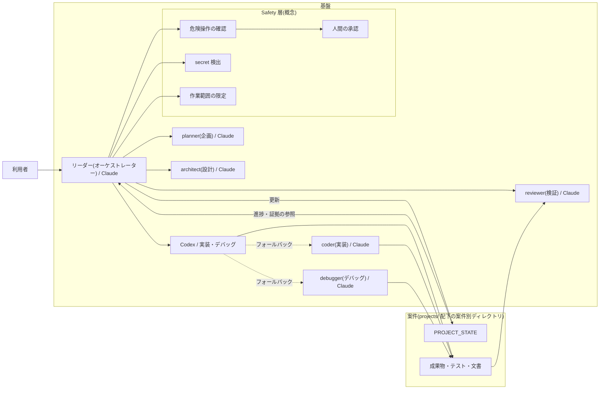
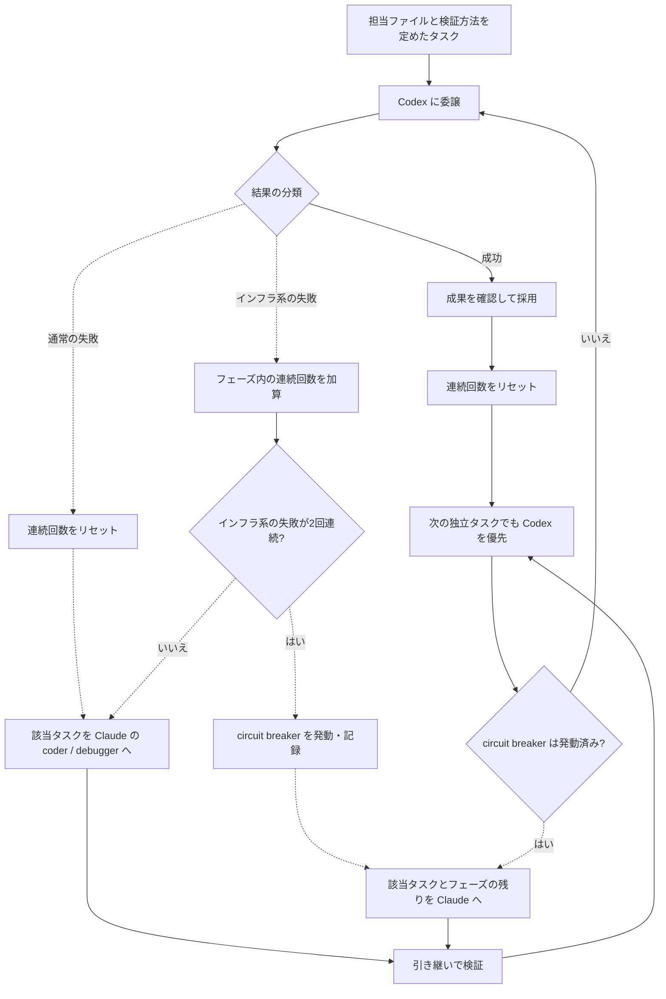

# アーキテクチャ

> 記述時点: 2026-10。内容は非公開の内部概要資料(v2 系)から概念レベルで書き下ろしたもので、内部仕様は今後変わる可能性があります。

## 概要

dev-factory は、個人の開発依頼を企画から納品へ運ぶための基盤です。Claude が判断や設計を受け持ち、Codex に実装を委ねます。小規模な確認では学習記録を残すところまで完走していますが、規模の大きい案件での成功率を示すものではありません。(検証ステータス: 実機検証済み / V01)

## 全体構成図

図は、指示・成果物・状態の関係をまとめたものです。Claude 側のリーダー(オーケストレーター)が役割を割り振り、OpenAI Codex を実装の実行先にします。矢印は主な受け渡しを表します。(検証ステータス: 実機検証済み / V02)

Safety 層を図に置いても、すべての操作が遮断できるという意味にはなりません。削除や公開、本番変更などは、人の判断を必要とする操作です。確認経路には検証済みの部分がありますが、操作種別を網羅した確認は済んでいません。(検証ステータス: 一部検証 / V19)

## 構成要素の説明

### リーダーと5役

リーダーは進行、担当の割り振り、統合、最終報告を受け持ちます。planner(企画)が依頼を要件へ整理し、architect(設計)が構成とタスクを定めます。coder(実装)と debugger(デバッグ)は Codex の代替を担い、reviewer(検証)は実装側から独立して成果物を確認します。この役割分担による一連の進行は、小規模な開発で確認されています。(検証ステータス: 実機検証済み / V01)

reviewer は実装者の完了報告をそのまま採用せず、依頼と成果物を照合して採点します。スコアは判断の結果であり、同一の入力から常に同じ点を得られる保証はありません。(検証ステータス: 実機検証済み / V06)

### Codex

実装の第一候補は Codex です。デバッグのほか、ファイルを大量に読む調査や集計、データ整形などの重い処理も優先して委ねる方針です。Claude 側は要点と証拠を受け取り、設計判断や統合に集中します。実機で確認された実装委譲の範囲は、小規模な開発の動作確認です。(検証ステータス: 実機検証済み / V02)

### PROJECT_STATE

PROJECT_STATE には依頼、承認された変更、進捗、実行担当、検証結果、再開時の手順をまとめます。フェーズが変わるたびにリーダーが記録し、会話が途切れても次の作業を特定できるようにする設計です。状態ファイルを使った手動再開の検証記録は、まだありません。(検証ステータス: 設計済み(未検証) / V10)

同じ状態ファイルの GOAL_CONTRACT で、到達したい状態と確かめ方、制約、停止の条件を整理します。completion gate は、その約束と最新の検証証拠を照らして完了可否を決める設計です。実案件で gate が停止を判断した記録は未確認です。(検証ステータス: 設計済み(未検証) / V11)

### Safety 層

基盤の共有領域への書き込みは、Claude が直接行う場合も Codex へ委ねる場合も承認の対象になります。この境界は検証されていますが、ハードリンクを介した書き込みには既知の課題があります。(検証ステータス: 実機検証済み / V15)

secret 検出は、秘密の混入が疑われる指示やファイル操作を止め、値を表示しないための仕組みです。資格情報をモデルに渡さず利用する経路の整備は途中で、あらゆる種類に対応できたわけではありません。(検証ステータス: 一部検証 / V16)

Codex に渡す作業範囲は、担当する案件とファイルを指示で限定します。ただし、その記述だけで範囲外への書き込みを技術的に封じることはできません。共有領域への委譲を承認へ回す検査と、実行先の書き込み制限は区別する必要があります。(検証ステータス: 一部検証 / V17)

### 基盤と案件の分離

手順や役割を提供する基盤に対し、コードやテストなどの成果物は `projects/` 配下の案件ごとの領域に置きます。基盤を変更する書き込みは、案件内の開発とは別に承認を受ける境界です。(検証ステータス: 実機検証済み / V15)

## 委譲とフォールバックの図

Codex の作業が失敗した場合は、同じ範囲と制約を保ったまま、該当タスクだけを Claude の coder または debugger に引き継ぎます。このフォールバックには実運用の記録があり、意図的に故障を起こした試験の結果ではありません。(検証ステータス: 実機検証済み / V03)

テスト未実施や不合格のままの報告など、Codex が応答できている失敗は「通常の失敗」です。次の独立タスクでは Codex を再び優先します。引き継ぎ時には既存の差分を確認し、時間切れ後も処理が続いていないかを確かめ、二重編集を避けます。(検証ステータス: 実機検証済み / V03)

呼び出しエラーや時間切れなどの「インフラ系の失敗」は、実装フェーズと統合・デバッグフェーズで別々に数えます。成功または通常の失敗で連続回数を戻し、2回続いたら circuit breaker により、そのフェーズの残りを Claude に切り替えます。発動した運用事例はありますが、発生頻度を評価したものではありません。(検証ステータス: 実機検証済み / V04)

## 載せていないもの

ここで扱うのは構成と責務の関係です。実行環境の場所、個人や案件を特定する情報、安全装置の実ファイル、設定内容、認証手順の内部、モデルの識別子や起動方法は掲載していません。図だけを使って内部環境を複製するための資料ではありません。

## 関連ドキュメント

- [README に戻る](../README.md)
- [開発フロー](development-flow.md)
- [役割](roles.md)
- [委譲と状態管理](delegation-and-state.md)
- [検証ステータス](verification-status.md)
