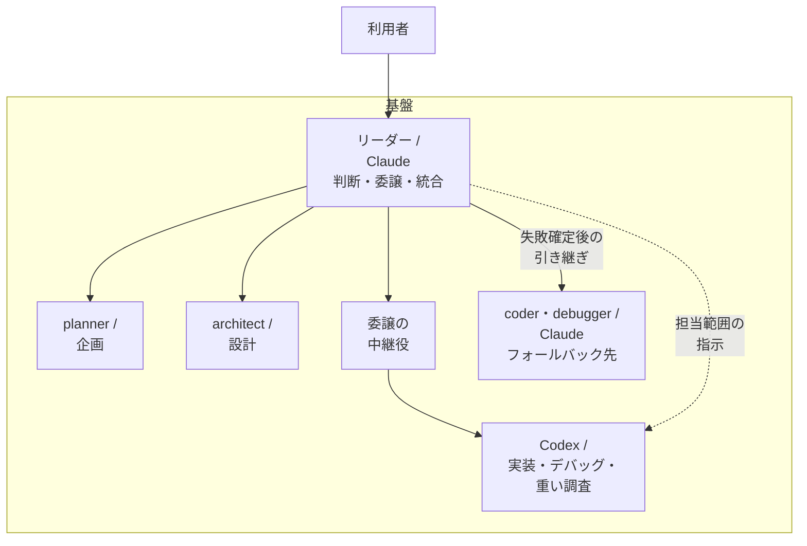
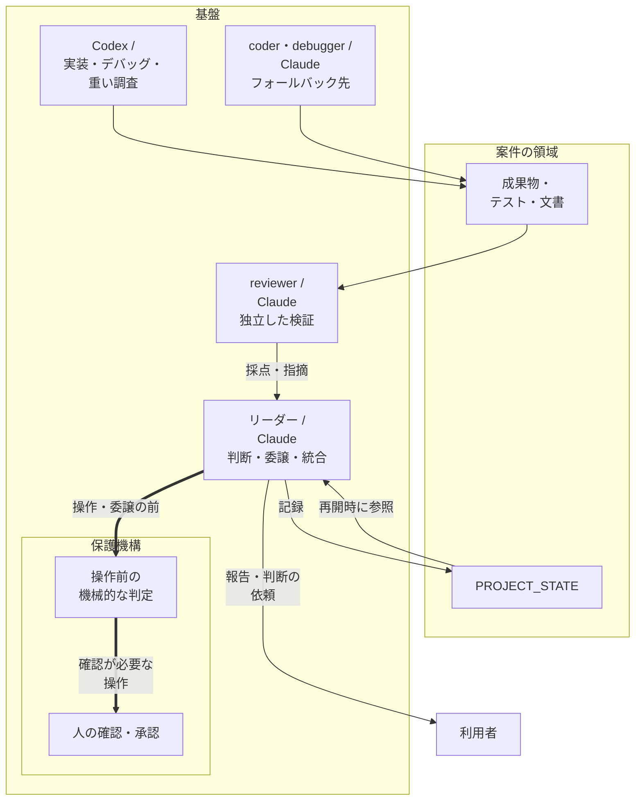
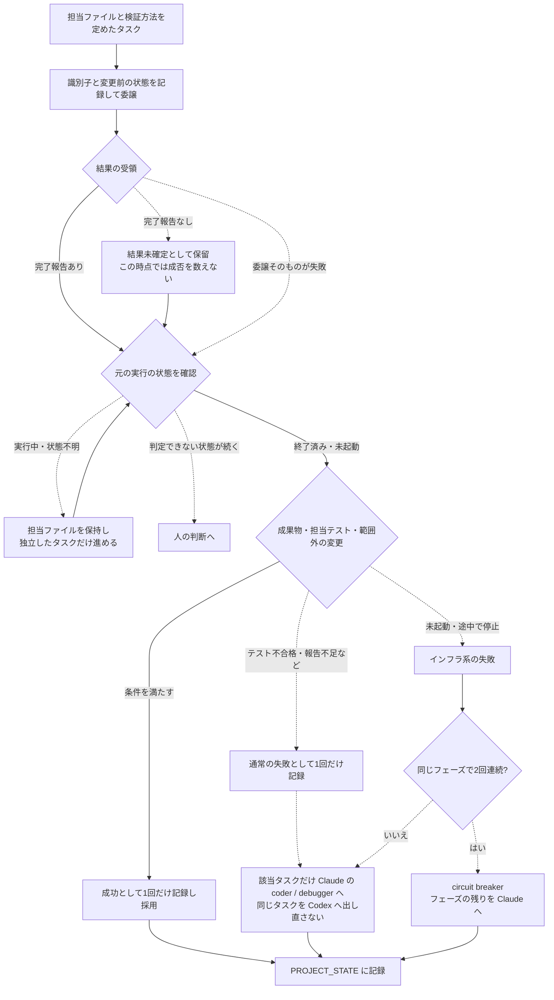
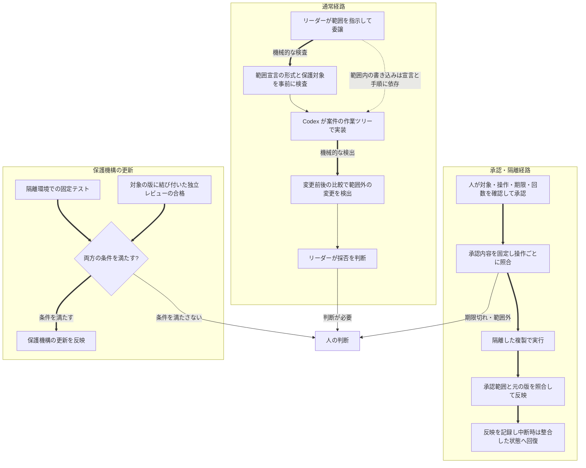

# アーキテクチャ

> 記述時点: 2026-11。基盤の現在のファイルと非公開の作業記録を確認し、公開向けに概念レベルで書き下ろしたものです。内部仕様は今後変わる可能性があります。

## 概要

dev-factory は、開発の依頼から成果物の検証までを進める基盤です。判断、実装、検証を分担し、リーダーが進捗と証拠をまとめます。2026-10-21 の初回作成版には、企画から納品と学習記録まで進めた実績があります。確認範囲は当時の小規模な開発であり、現在版の全工程や大規模な案件の成功率は確認していません。(検証ステータス: 実機検証済み / V01)

## 全体構成図

図 A は 2 つに分けて示します。図 A-1 は、利用者の依頼を受けたリーダーから、企画・設計・委譲の中継役・実装担当(Codex とフォールバック先)への委譲を示します。図 A-2 は、成果物の独立した検証、記録、保護機構、利用者への報告を示します。利用者・リーダー・Codex・coder と debugger、および「基盤」の枠は、両方の図に出る同じものです。線種は受け渡しと制限の仕組みを区別しています。

図 A-1: 依頼と委譲

図 A-2: 検証・記録・保護と報告

凡例: 実線は指示や成果物の受け渡し、太線は機械的な判定・制限、破線は宣言・手順に依存する制限です。図 A-2 のリーダーから保護機構への太線は、操作や委譲に先立つ検査を代表して示します。

削除や公開、本番環境の変更では、リーダーが人の判断へ戻す手順を持ちます。特定操作の拒否と承認の運用には確認記録がありますが、対象操作すべての実機確認は済んでいません。図の太線から、あらゆる公開手段を一律に止める保証を読み取ることはできません。(検証ステータス: 一部検証 / V19)

## 構成要素の説明

### リーダーと主要な5役

リーダー(オーケストレーター)は、作業の分解、担当の割り当て、統合と最終判断を担います。主要な5役は planner(企画)、architect(設計)、coder(実装)、debugger(デバッグ)、reviewer(検証)です。実装とデバッグは Codex を優先し、失敗が確定したタスクを coder または debugger に渡します。2026-10-21 の初回作成版には役割を分けて完走した記録があり、現在の全役割を改めて起動した結果ではありません。(検証ステータス: 実機検証済み / V01)

reviewer は、実装担当から独立して要件と成果物を照合し、採点と指摘を返します。2026-10-21 のレビューには対象版と応答の記録があります。点数にはモデルの判断が含まれ、同一入力で同じ点になる保証はありません。(検証ステータス: 実機検証済み / V06)

### 補助の役割

調査では、事実確認役が出典と記述の対応を確かめます。役割と手順の定義があり、2026-10-28 の運用記録にも登場します。ただし、現行の調査工程全体について、最終成果物と確認応答の原文までを結び付けた検証はしていません。(検証ステータス: 一部検証 / V09)

難しい判断を補うため、読み取り専用の難問相談役も置きます。重要度や利用状況から相談の可否を判定し、助言を採用するかはリーダーが決めます。2026-10-11 に相談の記録がありますが、現在版での無人実行や条件判定全体、助言による効果は未確認です。採用した方針の実装と検証は通常の担当へ渡します。(検証ステータス: 一部検証 / V31)

### 委譲の中継役と Codex

判断と実作業を分けるため、リーダーは委譲の中継役を通じて Codex に作業を渡します。実装、デバッグ、大量のファイルを読む調査や集計を優先して委ね、リーダーは要点と証拠を確認します。2026-10-10 と 2026-10-21 の当時版に委譲・受領の記録があります。作業全般への適合や使用量の削減効果まで示すものではありません。(検証ステータス: 実機検証済み / V02)

### PROJECT_STATE

中断後に二重編集を起こさないよう、PROJECT_STATE に進捗、担当、確認した成果物の版と再開先を残し、再開時には保存内容と未完了の実行を照合します。2026-10-26〜27 の模擬中断試験と、2026-11-08 の保存記録があります。保存の記録だけで、実際の会話整理後の復元や現行手順全体の成功を認定してはいません。(検証ステータス: 一部検証 / V10)

GOAL_CONTRACT には完了条件と検証方法を定め、completion gate で対象版の証拠と照合します。2026-10-21 の作成記録には、条件と証拠を残して独立レビュー後に完了とした経緯があります。条件未達による停止の実例は未確認です。通常経路では、完了の記録を内容に応じて拒否する汎用コードではなく、手順と独立レビューで支えています。(検証ステータス: 一部検証 / V11)

### 保護機構

基盤の共有部分を案件内の編集から守るため、直接の操作と委譲に対して書き込みの可否を判定します。2026-10-07 の旧構成の境界試験と、2026-10-28 の保守版のテスト記録があります。配置の照合もありますが、現在版への直接書き込み試験は再実施しておらず、認証関連の未照合部分やハードリンク経由の変更に課題が残ります。(検証ステータス: 一部検証 / V15)

秘密情報の混入には、入力時と操作前の検査、および値をモデルへ見せずに利用する経路で対処します。実装と、2026-10-01 の概要にある受入確認の記録を確認しています。検査対象は既知の形式や保存場所で、全種類の秘密やすべての出力経路を網羅してはいません。(検証ステータス: 一部検証 / V16)

担当外の変更には、範囲宣言の事前検査と、変更前後の比較による検出を組み合わせます。2026-10-26 の試験には宣言不足を拒否した記録があります。通常経路では、宣言の検査だけで全書き込みを許可ファイルへ隔離できるわけではなく、変更後の検出にも依存します。(検証ステータス: 一部検証 / V17)

### 基盤と案件の分離

共通の手順や保護機構は基盤側に置き、コード、テスト、文書は案件ごとの領域にまとめます。共有部分の変更には案件内とは別の承認を求めます。この境界の検証には上記の対象版と経路の制限があります。(検証ステータス: 一部検証 / V15)

## 委譲・結果の受領・引き継ぎの図

図 B は、報告を受け取る段階と元の実行の状態を確認する段階を分けています。成功を採用する場合も、失敗後に引き継ぐ場合も、状態と成果物を照合します。

凡例: 実線は通常の経路、破線は例外・失敗の経路です。この図の破線は、宣言による制限と機械的な制限の区別を表すものではありません。「結果未確定」は保留であり、「通常の失敗」「インフラ系の失敗」と区別します。図中の終了確認は判定ツールを使いますが、待機や引き継ぎを守るのはリーダーの手順です。

完了報告が欠けたり時間切れの通知が届いたりしても、それだけではインフラ系の失敗に加算しません。結果を保留し、元の実行と成果物を調べてから一度だけ確定・記録します。2026-10-29 の改訂版では過去データの再生と単体試験で計数を確認しています。改訂後の長時間処理を新たに実機で試した記録はなく、確定と保存はリーダーの手順に依存します。(検証ステータス: 一部検証 / V25)

正常な完了報告を受け取った後も、元の実行が終わったかを確認します。実行中または状態不明なら担当ファイルを確保したまま、独立した作業だけを進め、判断不能が続けば人へ戻します。2026-10-26〜27 の模擬試験と 2026-10-31 の引き継ぎ記録があります。判定ツールは別担当の開始を自動で禁止せず、残った背景処理を観測できない場合もあります。(検証ステータス: 一部検証 / V26)

未起動で、依頼が受領されていないと確認できた場合だけ、新しい識別子で出し直せます。失敗が確定した同じタスクは Codex に再委譲せず、範囲と制約を保って coder または debugger に渡します。2026-10-21 と 2026-10-31 の当時版に引き継ぎの実績がありますが、想定する故障すべてを網羅した試験ではありません。(検証ステータス: 実機検証済み / V03)

起動や接続で委譲そのものが失敗した場合は、インフラ系の失敗です。確定した同種の失敗が同じフェーズで2回続くと、circuit breaker によりそのフェーズの残作業を Claude へ切り替えます。成功または通常の失敗で連続回数を戻し、次のフェーズには持ち越しません。旧方式には発動記録があり、2026-10-29 改訂版では計数の再生試験を確認しています。改訂後の実運用での発動は未確認で、残作業を移す判断はリーダーが行います。(検証ステータス: 一部検証 / V04)

複数の作業が共有の実行基盤を使う場合、別の作業の終了によって処理中の実行を止めないよう保護します。通常の委譲がすべてこの基盤を通るという意味ではありません。2026-10-31 の Mac で継続と対象作業の中断を確認した記録があります。中断指示の厳密な時刻や全プロセスの終了保証までは確認しておらず、共有基盤の全体テストにも既知の失敗が残ります。(検証ステータス: 実機検証済み / V27)

## 通常経路と承認・隔離経路の図

図 C は、案件の作業領域へ委譲する通常経路と、承認範囲を固定して隔離した複製で実行する経路を並べています。保護機構そのものの更新には、隔離テストと独立レビューの両方を反映条件として設けます。

凡例: 実線は情報や判断の受け渡し、太線は機械的な判定・制限、破線は宣言・手順に依存する制限です。太線は承認の目的や内容の妥当性まで自動で保証するものではありません。

事前承認では、人が許可する対象と操作を確認し、機械側で範囲・期限・回数を固定して照合します。2026-10-16〜24 の当時版に発行と条件外の拒否の記録があります。承認内容の妥当性には人の判断が必要で、更新後の現在版ですべての条件を再試験してはいません。(検証ステータス: 一部検証 / V18)

承認・隔離経路では複製上で変更を作り、承認範囲と元の版を確認して反映します。2026-10-16〜24 の記録で隔離実行と反映を確認しています。隔離が適用されるのは実装担当側のツールで、中継部分と実行器は信頼する前提です。現在の実行環境ですべての経路を再検証してはいません。(検証ステータス: 一部検証 / V28)

反映中の中断には、反映の記録を使って変更前か変更後の整合した状態へ回復する処理を備えます。2026-10-24 の試験環境で障害を注入し、回復を繰り返しても状態が変わらないことを確認しています。実運用の入口を通る試験ではなく、回復不能な状態や残った排他制御には人の対応が必要です。(検証ステータス: 一部検証 / V29)

保護機構の更新では、評価対象の版に結び付いた独立レビューと隔離テストを反映の条件にします。2026-10-28 の保守版には、両方を経て正常に反映した実績があります。確認はその正常経路の範囲で、中断や時間超過の全分岐は未確認です。レビュー依頼の表現が判断を誘導する可能性も機械的には排除できません。(検証ステータス: 実機検証済み / V30)

## 宣言による制限と機械的な制限

範囲を伝える指示と、その範囲を検査する処理は異なる役割を持ちます。通常経路の事前検査・事後検出と、承認・隔離経路の書き込み制限を混同しないよう、依存先を次に整理します。

| 宣言・手順に依存する制限 | 機械的な判定・制限 |
|---|---|
| 担当する案件とファイルの範囲を指示する | 範囲宣言の形式と保護対象を開始前に検査する |
| タスクを分割し、担当ファイルが重ならないよう割り当てる | 変更前後を比較し、範囲外の変更を検出する |
| 元の実行が終わるまで同じ範囲に別担当を入れない | 終了確認の判定ツールで実行状態を調べる |
| 基盤を変える目的と変更内容を人が承認する | 保護領域への書き込みを判定する |
| 許可する作業の目的と範囲を人が決める | 承認範囲を固定・照合し、複製を隔離して実行する |
| 回復不能な状態を人が調べ、対応を決める | 反映を記録し、中断後の回復を行う |
| 保護機構の変更内容を独立して評価する | 隔離テストと独立レビューの合格を反映条件にする |
| 完了条件と証拠を照合し、完了を記録する | 通常経路の完了内容を一律に拒否する汎用コードはない |
| 公開の可否と実施を人が判断する | 特定操作には拒否の処理があるが、全公開手段の遮断は保証しない |

この区別に加えて、自動モードには操作の意味を読む判定があります。その判定は意味的・確率的で、固定条件の機械的な照合とは性質が異なります。2026-09-05 の概要には自己設定の変更を止めた記録がありますが、元の実行記録と当時版は未照合で、現在版の完全な遮断を示す証拠ではありません。(検証ステータス: 一部検証 / V13)

## 載せていないもの

ここで示すのは、責務、情報の流れ、制限の仕組みとその確認範囲です。環境固有の設定や保存先、個人・案件を特定する情報、認証の内部、具体的なモデルや起動方法は扱いません。構成図は内部環境を再現するための手順書ではありません。

## 関連ドキュメント

- [README に戻る](../README.md)
- [開発フロー](development-flow.md)
- [役割](roles.md)
- [委譲と状態管理](delegation-and-state.md)
- [検証ステータス](verification-status.md)
