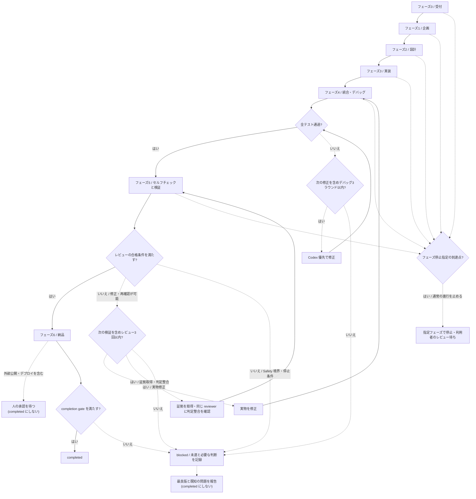
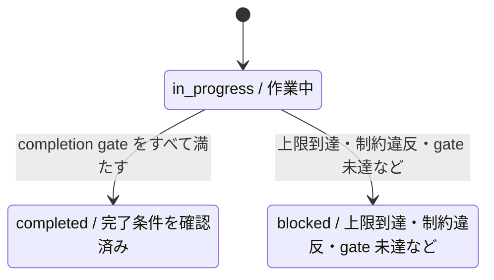

# 開発フロー

> 記述時点: 2026-11。基盤の現在のファイルと非公開の作業記録を確認し、公開向けに概念レベルで書き下ろしたものです。内部仕様は今後変わる可能性があります。

## 全体の流れ

リーダー(オーケストレーター)が、受付から企画、設計、実装、検証、納品へ進行をつなぎます。各フェーズの入口で元の依頼を読み直し、成果物の方向を確認します。2026-10-21 の初回作成版には学習記録まで終えた記録がありますが、現在版の全工程の再実行や、大規模案件の完走率を示してはいません。(検証ステータス: 実機検証済み / V01)

次の図は通常の進行と修正経路を示します。レビューのやり直しは実施記録がありますが、上限まで不合格が続いて `blocked` へ進む経路は未検証です。(検証ステータス: 一部検証 / V07)

図の実線は通常の進行と修正後の戻り先、破線は条件に応じた分岐を表します。この図の破線は、宣言による制限と機械的な制限の区別を表すものではありません。フェーズノードから停止指定の判定への破線は、そのフェーズの完了後を表します。F4 は TEST の「はい」側、F5 は PASS の「はい」側で、次のフェーズへ進む前に停止指定を判定します。停止対象に到達したときは、次のフェーズへ進まず利用者のレビューを待ちます。この分岐を実際に通った個別の記録は未確認です。

公開を伴う依頼では、納品後も外部公開・デプロイの前に人の承認を待ちます。承認待ちの間は `completed` にせず、承認を得た後も完了条件と証拠を照合します。これは進行と公開の判断を分ける運用手順です。特定操作の制限に関する過去の記録はありますが、すべての公開手段を機械的に止める保証はありません。(検証ステータス: 一部検証 / V19)

## 各フェーズの入力・出力

| フェーズ | 入力 | 出力と引き継ぎ | 検証の位置付け |
|---|---|---|---|
| 0 受付 | 利用者の依頼 | 案件用の領域と、依頼原文を保持した PROJECT_STATE。同名案件は上書きしない | 同名案件を上書きしない個別挙動の検証記録はない |
| 1 企画 | 依頼原文 | planner(企画)による要件・成功条件・仮定。仮定を中間報告する | (検証ステータス: 実機検証済み / V01) |
| 2 設計 | 要件 | architect(設計)による構成、検証方法、担当範囲の分割 | (検証ステータス: 実機検証済み / V01) |
| 3 実装 | 設計とタスク | Codex 優先の実装とテスト。coder(実装)はフォールバックを担当 | (検証ステータス: 実機検証済み / V02) |
| 4 統合・デバッグ | 実装、テスト、失敗の再現情報 | リーダーによる全テストの実行。失敗時は Codex、フォールバック時は debugger(デバッグ)が対応 | (検証ステータス: 実機検証済み / V01) |
| 5 検証 | 成果物、依頼、設計、検証証拠 | セルフチェック後に reviewer(検証)が独立して確認し、採点と指摘を返す | (検証ステータス: 実機検証済み / V06) |
| 6 納品 | 合格した成果物と完了条件 | README、場所と使い方、仮定・スコア・残課題の報告、続いて学習記録 | (検証ステータス: 実機検証済み / V01) |

実装では共通のインターフェースを先に固め、依存する作業をその後に置きます。並列に進めるタスクには、同じファイルを割り当てません。この分担での運用記録はありますが、並列化による時間短縮の定量比較はありません。(検証ステータス: 実機検証済み / V05)

フェーズの区切りでは PROJECT_STATE に進捗を保存し、保存内容を読み直して次の作業を確認する手順です。2026-11-08 には模擬的な保存と再開先の記録がありますが、実際に会話を整理した後の復元を実証したものではありません。(検証ステータス: 一部検証 / V10)

## 品質ゲート

### テストとセルフチェック

実行担当から成功の報告を受けても、リーダーが全テストを再実行して確認します。未実施やスキップは合格の代わりにしません。テストを通して検証へ進む流れは、小規模な完走確認に含まれています。(検証ステータス: 実機検証済み / V01)

reviewer を呼ぶ前には、要件、設計、タスクと成果物の対応や証拠の不足をセルフチェックで調べます。独立した採点の前にこの手順が組み込まれていますが、日付と対象版に結び付くセルフチェック自体の実施記録は確定できません。レビュー前のテスト結果だけで手順全体の実施を認定しません。(検証ステータス: 実装済み(動作未検証) / V08)

### reviewer の採点

総合点は、要件を満たす度合いに 0.4、テスト・検証に 0.3、コード品質に 0.2、文書に 0.1 の重みを掛けて算出します。合格には 0.85 以上に加え、`passed` が真であること、重大な誤りがないこと、加重平均を小数第2位に丸めた点と総合点が整合することが必要です。必須要件や完了条件、重大な制約の未達が指摘に残る場合も合格にできません。(検証ステータス: 実機検証済み / V06)

不合格なら、成果物の修正、足りない証拠の取得、判定の不整合の確認を分けて対応します。リーダーが採点結果を書き換えることはせず、必要な対応後に再レビューします。レビューは最大3回で、届かなければ最良版と最終点、未達事項、利用者に求める判断を残して `blocked` とする規則です。再レビューの実績はありますが、この上限停止の経路には確認記録がありません。(検証ステータス: 一部検証 / V07)

レビュー後に成果物を変更した場合は、以前のスコアだけを完了の根拠にせず、変更の影響を受ける部分を確かめ直す手順として定めています。レビュー対象の版と証拠を対応させることが重要です。

## 同じエラーが2回続いたら別の方法

同じエラーへの対応で2回失敗した場合、次は仮説や修正方法を変える手順です。その時点で作業全体を止める規則ではなく、停止は修正回数の上限や制約に照らして判断します。方針変更は担当の定義と進行手順に組み込まれていますが、規定どおり実行した記録は未確認です。(検証ステータス: 実装済み(動作未検証) / V23)

## デバッグ最大3ラウンド

統合時のテスト失敗は、再現情報を添えて Codex 優先で修正へ回します。デバッグを最大3ラウンドで区切り、未解決なら原因の調査結果と残る仮説を整理して `blocked` にする手順です。報告には最良版と既知の問題を残し、`completed` としません。上限の規定はありますが、上限到達で停止した実行記録は未確認です。(検証ステータス: 実装済み(動作未検証) / V23)

## フェーズ停止指定

利用者が「設計で止めて」と指定した場合、設計までを成果としてまとめ、利用者の確認を待ってから次へ進みます。停止の指定を自動進行より優先する手順ですが、指定した工程で実際に止めた記録は未確認です。

手動再開には、2026-10-26〜27 の隔離環境で中断を模擬して再開した記録があります。この試験は工程の停止指定を受けた後の再開とは別の経路であり、実際に会話を整理した後の復元や、現在の全条件に沿った再開は未確認です。(検証ステータス: 一部検証 / V10)

## 完了条件と status の遷移

完了の判断を報告文だけに頼らないため、GOAL_CONTRACT に目的、完了条件、検証方法、制約、変更範囲、やり直しの上限と停止条件を記録します。リーダーが元の依頼と承認済みの変更を反映し、reviewer が成果物と最新の検証証拠を照合する手順です。2026-10-21 の初回作成版には条件と証拠を記録し、レビュー後に完了とした経緯がありますが、条件の未達で停止した実例は未確認です。(検証ステータス: 一部検証 / V11)

completion gate では、完了条件の達成、検証の成功、対象版に合った証拠、レビュー合格、重大な制約違反がないこと、停止条件に当たらないことを確認します。すべてそろえば `completed` とし、未達によって進めない場合は `blocked` として必要な判断を残す規則です。通常の完了記録を内容に基づいて拒否する汎用コードではなく、リーダーの照合と独立レビューで判定します。未達時にこの経路で停止した実例は未確認です。(検証ステータス: 一部検証 / V11)

この図の矢印は、作業開始、完了条件の達成、上限到達や制約違反による停止の遷移を示します。作業を続ける間は `in_progress` の進捗と次の手順を更新し、中断した場合は記録を読み直して未完了の作業を引き継ぎます。2026-10-26〜27 の隔離試験での模擬再開は一部の経路の確認であり、この図全体や自動再開を保証しません。(検証ステータス: 一部検証 / V10)

## 関連ドキュメント

- [README に戻る](../README.md)
- [アーキテクチャ](architecture.md)
- [役割](roles.md)
- [委譲と状態管理](delegation-and-state.md)
- [検証ステータス](verification-status.md)
- [事例](case-study.md)
