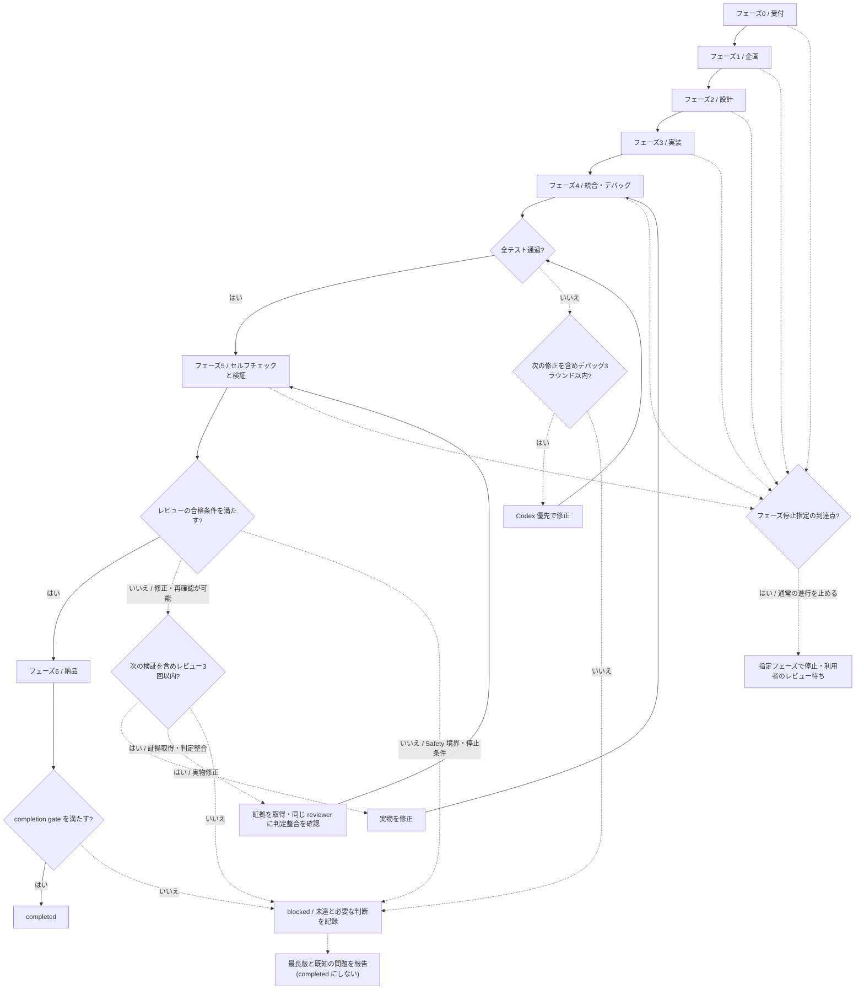
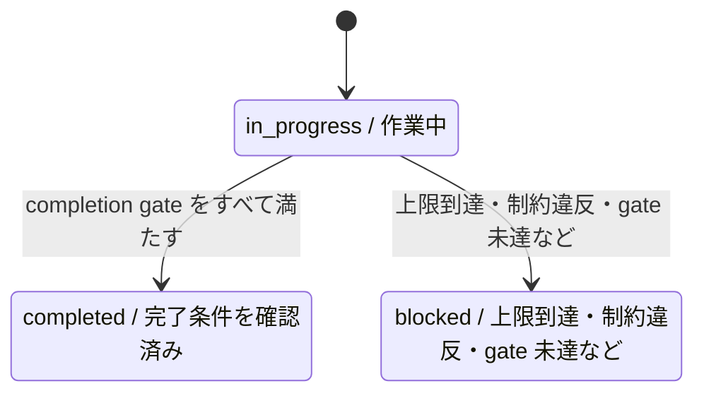

# 開発フロー

> 記述時点: 2026-10。内容は非公開の内部概要資料(v2 系)から概念レベルで書き下ろしたもので、内部仕様は今後変わる可能性があります。

## 全体の流れ

リーダー(オーケストレーター)が、受付から企画、設計、実装、検証、納品へ進行をつなぎます。各フェーズの入口で元の依頼を読み直し、成果物の方向を確認します。学習記録まで含む完走は小規模な開発で確認されており、大規模案件の完走率は測定していません。(検証ステータス: 実機検証済み / V01)

次の図は通常の進行と修正経路を示します。レビューのやり直しは実施記録がありますが、上限まで不合格が続いて `blocked` へ進む経路は未検証です。(検証ステータス: 一部検証 / V07)

図のフェーズノードから停止指定の判定への破線は、そのフェーズの完了後を表します。F4 は TEST の「はい」側、F5 は PASS の「はい」側で、次のフェーズへ進む前に停止指定を判定します。停止対象に到達したときは、次のフェーズへ進まず利用者のレビューを待ちます。これは依頼に応じて進行を制御する手順で、上の全フェーズ完走の確認だけから、この分岐自体が検証されたとは言えません。フェーズ停止指定そのものには、個別の検証記録がありません。

## 各フェーズの入力・出力

| フェーズ | 入力 | 出力と引き継ぎ | 検証の位置付け |
|---|---|---|---|
| 0 受付 | 利用者の依頼 | 案件用の領域と、依頼原文を保持した PROJECT_STATE。同名案件は上書きしない | 同名案件を上書きしない個別挙動の検証記録はない |
| 1 企画 | 依頼原文 | planner(企画)による要件・成功条件・仮定。仮定を中間報告する | (検証ステータス: 実機検証済み / V01) |
| 2 設計 | 要件 | architect(設計)による構成、検証方法、担当範囲の分割 | (検証ステータス: 実機検証済み / V01) |
| 3 実装 | 設計とタスク | Codex 優先の実装とテスト。coder(実装)はフォールバックを担当 | (検証ステータス: 実機検証済み / V02) |
| 4 統合・デバッグ | 実装、テスト、失敗の再現情報 | リーダーによる全テストの実行。失敗時は Codex、フォールバック時は debugger(デバッグ)が対応 | (検証ステータス: 実機検証済み / V01) |
| 5 検証 | 成果物、依頼、設計、検証証拠 | セルフチェック後に reviewer(検証)が独立して確認し、採点と指摘を返す | (検証ステータス: 実機検証済み / V06) |
| 6 納品 | 合格した成果物と完了条件 | README、場所と使い方、仮定・スコア・残課題の報告、続いて学習記録 | (検証ステータス: 実機検証済み / V01) |

実装では共通のインターフェースを先に固め、依存する作業をその後に置きます。並列に進めるタスクには、同じファイルを割り当てません。この分担での運用記録はありますが、並列化による時間短縮の定量比較はありません。(検証ステータス: 実機検証済み / V05)

## 品質ゲート

### テストとセルフチェック

実行担当から成功の報告を受けても、リーダーが全テストを再実行して確認します。未実施やスキップは合格の代わりにしません。テストを通して検証へ進む流れは、小規模な完走確認に含まれています。(検証ステータス: 実機検証済み / V01)

reviewer を呼ぶ前には、要件、設計、タスク、成果物の食い違いや、証拠の不足をセルフチェックで探します。この確認を挟んでも、reviewer の独立した採点は省略しません。(検証ステータス: 実機検証済み / V08)

### reviewer の採点

総合点は、要件を満たす度合いに 0.4、テスト・検証に 0.3、コード品質に 0.2、文書に 0.1 の重みを掛けて算出します。合格には 0.85 以上に加え、`passed` が真であること、重大な誤りがないこと、加重平均を小数第2位に丸めた点と総合点が整合することが必要です。必須要件や完了条件、重大な制約の未達が指摘に残る場合も合格にできません。(検証ステータス: 実機検証済み / V06)

不合格なら、成果物の修正、足りない証拠の取得、判定の不整合の確認を分けて対応します。リーダーが採点結果を書き換えることはせず、必要な対応後に再レビューします。レビューは最大3回で、届かなければ最良版と最終点、未達事項、利用者に求める判断を残して `blocked` とする規則です。再レビューの実績はありますが、この上限停止の経路には確認記録がありません。(検証ステータス: 一部検証 / V07)

レビュー後に成果物を変更した場合は、以前のスコアだけを完了の根拠にせず、変更の影響を受ける部分を確かめ直します。レビュー対象の版と証拠を対応させることが重要です。(検証ステータス: 実機検証済み / V06)

## 同じエラーが2回続いたら別の方法

同じエラーへの対応で2回失敗した場合、次は仮説や修正方法を変えます。これは retry の方針であり、その時点で作業全体を止める条件ではありません。停止するかどうかは、修正回数の上限や制約などで別に判断します。この規則自体の動作確認は記録されていません。(検証ステータス: 設計済み(未検証) / V23)

## デバッグ最大3ラウンド

統合時のテスト失敗は、再現情報を添えて Codex 優先で修正へ回します。最大3ラウンドで解消しなければ、原因について分かったことと残る仮説を整理し、`blocked` を記録します。その後の検証・報告では最良版と既知の問題を提示し、`completed` へ上書きしません。上限による停止の実動作は未検証です。(検証ステータス: 設計済み(未検証) / V23)

## フェーズ停止指定

利用者が「設計で止めて」と指定した場合、設計までを成果としてまとめ、レビューを受けるまで実装へ進みません。停止の指示は自動進行より優先する手順です。停止後の状態に基づく手動再開は設計されているものの、再開の実機検証記録はありません。フェーズ停止指定には、個別の検証記録がありません。

## 完了条件と status の遷移

GOAL_CONTRACT は、目的、検証可能な完了条件、検証方法、制約、変更範囲、既存のやり直し上限、停止条件、最新の独立した検証証拠を結び付けます。依頼の原文と承認済みの変更に沿って、この内容をリーダーがまとめ、reviewer が照合する設計です。(検証ステータス: 設計済み(未検証) / V11)

completion gate では、約束した完了条件、成功した検証、現在の成果物に対応する証拠、レビュー合格、重大な制約違反の不在、停止条件への非該当をすべて確認します。成立して初めて `completed` とし、成立しない場合は `blocked` として必要な判断を残します。報告を送っただけでは完了になりません。この gate の実案件での停止判定は未検証です。(検証ステータス: 設計済み(未検証) / V11)

この図は作業開始と、上限到達・制約違反・完了判定時などの状態遷移を示します。作業を続けられる間は `in_progress` で進捗と次の手順を更新し、中断後は状態記録を読んで未完了の作業から再開する設計です。図は自動再開を保証するものではありません。(検証ステータス: 設計済み(未検証) / V10)

## 関連ドキュメント

- [README に戻る](../README.md)
- [アーキテクチャ](architecture.md)
- [役割](roles.md)
- [委譲と状態管理](delegation-and-state.md)
- [検証ステータス](verification-status.md)
- [事例](case-study.md)
